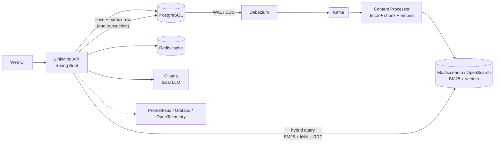

# LinkMind

**Save a link. Ask questions across everything you've saved.**

LinkMind is a smart bookmarking and knowledge-search tool built with Java and Spring Boot. It is a six-month build that starts as a simple REST API and evolves, one deliberate step at a time, into an event-driven, observable, AI-powered system running on Kubernetes.

> **Status: work in progress.** Started 11 Nov 2026. This README describes both what exists today and the target architecture. The [roadmap](#roadmap) below shows exactly what is done. Nothing is claimed as finished until it is checked off.

<!-- TODO (v5): add a 2-minute demo GIF here -->

---

## What it does

| Capability | Status |
|---|---|
| Save a URL or note, generate a short link | Planned (v1) |
| Persistent storage, optimized queries | Planned (v2) |
| Auth, caching, resilience, observability | Planned (v3) |
| Async content fetching and chunking via events | Planned (v4) |
| Hybrid search and RAG chat over saved content | Planned (v5) |

---

## Architecture

> Target architecture (v5). Diagram will be updated to match reality as each version ships.



### Key design decisions

Each of these will be documented as a short write-up in [`/docs/decisions`](docs/decisions) as it is made.

| Decision | Why |
|---|---|
| Transactional outbox + Debezium instead of dual-writing to DB and Kafka | A crash between "DB commit" and "Kafka publish" must not lose or duplicate events |
| Idempotent consumers + dead-letter queue | Kafka delivers at-least-once; consumers must tolerate redelivery and poison messages |
| Hybrid search (BM25 + vectors fused with RRF) over pure vector search | Pure vector search misses exact terms such as error codes and identifiers |
| Virtual threads for I/O-bound work | Benchmarked against platform threads, see [`/docs/benchmarks`](docs/benchmarks) |
| Local LLM via Ollama | No external API dependency or data leaving the machine |
| Output groundedness check on RAG answers | Every claim in a generated answer is verified against the retrieved context |

---

## Tech stack

| Area | Technology |
|---|---|
| Language / runtime | Java 25 (also tested on 21) |
| Framework | Spring Boot 4.x, Spring Framework 7 |
| Persistence | PostgreSQL, Spring Data JPA / Hibernate, HikariCP |
| Caching | Redis (cache-aside) |
| Security | Spring Security, JWT, OAuth2/OIDC |
| Resilience | Resilience4j, Spring native `@Retryable` / `@ConcurrencyLimit` |
| Messaging | Apache Kafka, Spring for Kafka, Debezium |
| Search / AI | Elasticsearch or OpenSearch, Spring AI 2.x, Ollama |
| Observability | Micrometer, Prometheus, OpenTelemetry, Grafana, structured JSON logs |
| Testing | JUnit 5, Mockito, Testcontainers |
| Infrastructure | Docker, Docker Compose, Kubernetes (Minikube/Kind) |
| Frontend | React (architecture-focused, minimal UI) |

*The stack list shows the intended end state. Items are added to the table above as they are actually integrated.*

---

## Roadmap

Built in public, one version per phase. Each version is tagged in Git (`v1`, `v2`, ...).

- [ ] **v1 (Month 2):** REST API, save + shorten link, CRUD, containerized, tested
- [ ] **v2 (Month 3):** Postgres persistence, N+1 fixed, indexes, pagination, before/after query plans documented
- [ ] **v3 (Month 4):** JWT + OAuth2, Redis caching, circuit breakers and retries, metrics/logs/traces, Grafana dashboard
- [ ] **v4 (Month 5):** `BookmarkSaved` event via outbox, Debezium and Kafka, async content processor, idempotent consumer + DLQ, deployed to local Kubernetes
- [ ] **v5 (Month 6):** hybrid search, RAG chat with a local LLM, guardrails, minimal UI, full deployment

Earlier groundwork (Month 1): a standalone module comparing virtual threads against platform threads, with benchmarks in [`/docs/benchmarks`](docs/benchmarks).

---

## Getting started

> Instructions will be filled in with v1. The target experience is one command:

```bash
# Prerequisites: JDK 25 (or 21), Docker
git clone https://github.com/<your-username>/linkmind.git
cd linkmind
docker compose up
```

### Running tests

```bash
./mvnw verify    # unit + integration tests (Testcontainers needs Docker running)
```

### Local Kubernetes (from v4)

```bash
# TODO: kind/minikube setup and manifests, added in v4
```

---

## Project structure

```
linkmind/
├── src/                  # application source
├── docs/
│   ├── decisions/        # short architecture decision records
│   ├── benchmarks/       # virtual threads vs platform threads, query plans
│   └── diagrams/
├── k8s/                  # Kubernetes manifests (v4+)
├── docker-compose.yml
└── README.md
```

---

## What I learned and trade-offs

*This section grows with the project. Each version adds a short entry on what broke, what I measured, and what I would do differently.*

- **Month 1:** (virtual thread benchmark findings go here)
- **v1:** ...
- **v2:** (N+1 before/after numbers go here)
- **v3:** ...
- **v4:** ...
- **v5:** ...

---

## Author

Built by Santosh Kumar Chitti as a six-month deep dive into backend systems, distributed architecture, and applied AI.
[LinkedIn](www.linkedin.com/in/santoshkumarch1) · [GitHub](https://github.com/santosh034)

